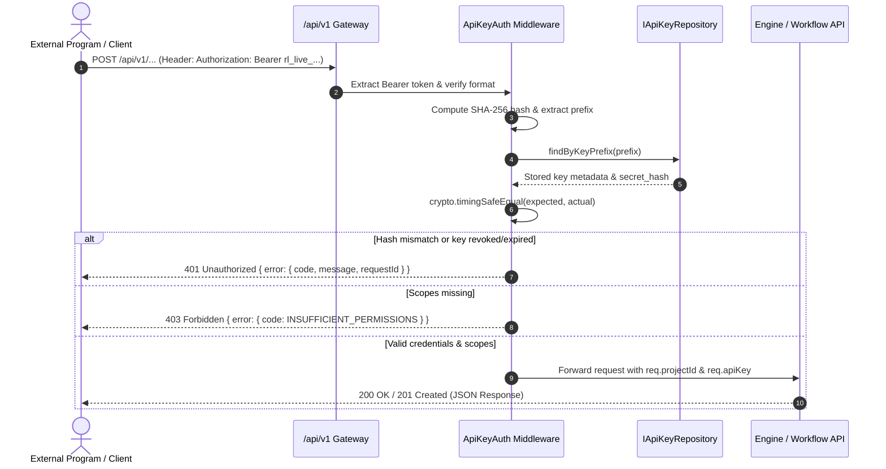

# Relay — Comprehensive Project Architecture & Technical Report

**Project Title:** Relay — Real-Time Collaborative Workflow Studio & DAG Engine  
**Version:** 1.1.0  
**Monorepo:** `relay-workspace`  
**Date:** October 2026  
**Status:** Tested & Fully Operational (44/44 Unit & Integration Tests Passing)

---

## 1. Executive Summary

**Relay** is an enterprise-grade, real-time collaborative workflow automation platform, Directed Acyclic Graph (DAG) execution engine, and public integration gateway. Designed as a modern, self-hostable alternative to Zapier, Make, and n8n, Relay enables cross-functional teams to visually construct, validate, execute, and programmatically trigger complex data routing workflows.

Key highlights of Relay:
- **Interactive Visual Canvas:** High-performance graph canvas built with `@xyflow/react` and a bespoke tactile Neumorphic/Skeuomorphic design system featuring dynamic status LEDs, custom bezier connectors, and responsive node palettes.
- **Topological DAG Execution Engine:** Deterministic, safe workflow scheduler executing nodes in topological order with real-time step streaming (`pending`, `running`, `succeeded`, `failed`, `skipped`).
- **Conditional Branch Routing:** Dynamic evaluation of condition nodes with automated downstream branch deactivation, ensuring non-matching execution paths are cleanly skipped.
- **Public Integration API Gateway (`/api/v1`):** Cryptographically secure, high-entropy API keys (`rl_live_...`), timing-safe SHA-256 hash verification, fine-grained scopes (`workflows:read`, `workflows:execute`, `executions:read`, `webhooks:manage`), sliding-window rate limiting, and request correlation IDs (`X-Request-Id`).
- **Real-Time Collaboration & Presence:** Socket.IO room sync with live peer cursors, node selection badges, and active collaborator avatars.
- **Conflict-Free Revision Control:** Optimistic concurrency control (`expectedRevision`) preventing lost updates or race conditions across multiple active editors.
- **Dual-Storage Resilience:** Zero-dependency in-memory repository for local development and rapid testing, seamlessly backed by Supabase PostgreSQL with automated schema migrations and version history snapshots.

---

## 2. Monorepo Architecture & Directory Layout

Relay is architected as an **npm workspaces monorepo**, cleanly separating concerns into independent applications and modular, strongly typed packages.

```
relay/
├── apps/
│   ├── web/                     # Frontend Studio Application
│   │   ├── src/
│   │   │   ├── components/      # UI components (Canvas, TopNav, NodePalette, Inspector)
│   │   │   │   ├── layout/      # Neumorphic layout bars (Header, InspectorPanel, NodePalette)
│   │   │   │   ├── nodes/       # Custom React Flow nodes (Trigger, Transform, Condition, Output)
│   │   │   │   └── ui/          # Tactile primitives (NeumoButton, NeumoCard, StatusLED)
│   │   │   ├── hooks/           # useWorkflow (Socket.IO sync, state updates, execution events)
│   │   │   ├── styles/          # Tailwind & Neumorphic CSS tokens and shadow models
│   │   │   └── App.tsx          # Root studio shell and canvas orchestrator
│   │   ├── package.json
│   │   └── vite.config.ts
│   │
│   └── server/                  # Backend API, Integration Gateway & Real-Time Server
│       ├── src/
│       │   ├── index.ts         # Server bootstrap and port listener
│       │   ├── server.ts        # Express REST API routes, /api/v1 router & error handler
│       │   ├── sockets.ts       # Socket.IO room lifecycle, presence, and live execution streaming
│       │   └── integrations/    # Public Integration Gateway Layer
│       │       ├── api-key-auth.ts     # Timing-safe auth & scope validation middleware
│       │       ├── api-key-routes.ts   # Key lifecycle endpoints (create, list, revoke)
│       │       ├── request-context.ts  # X-Request-Id & sliding-window rate limiting
│       │       ├── errors.ts           # Standard ApiError classes & JSON envelope serializer
│       │       └── index.ts            # Public integrations barrel exports
│       ├── test/
│       │   ├── server.test.ts   # Internal REST API integration tests (8 passed)
│       │   ├── sockets.test.ts  # WebSockets realtime integration tests (4 passed)
│       │   └── api-keys.test.ts # Public API Key & Scoped Auth tests (8 passed)
│       ├── package.json
│       └── tsconfig.json
│
├── packages/
│   ├── shared/                  # Common Contracts & Types
│   │   └── src/                 # Node/Edge schemas, ApiKey contracts, Socket event interfaces
│   │
│   ├── engine/                  # Pure DAG Execution & Safe Evaluation Library
│   │   ├── src/
│   │   │   ├── runner.ts        # Topological execution runner and event emitter
│   │   │   ├── scheduler.ts     # Kahn's algorithm & topological sorting
│   │   │   ├── validator.ts     # Cycle detection, edge validation, structural DAG checks
│   │   │   └── evaluators/      # Sandboxed built-in transforms and condition operators
│   │   └── test/                # Unit tests for runner, validator, and evaluators (24 passed)
│   │
│   └── database/                # Repository Pattern & Database Adapters
│       ├── src/                 # IRepositories, IApiKeyRepository, in-memory store, Supabase client
│       └── test/                # Revision locking & execution persistence tests
│
├── database/
│   └── migrations/              # Supabase PostgreSQL DDL (tables, indexes, RLS policies)
│       ├── 001_initial_schema.sql         # Projects, workflows, versions, executions
│       └── 002_integration_api_keys.sql   # Integration API keys with indices & RLS
│
├── .env.example                 # Environment variable templates
├── package.json                 # Monorepo root workspace configuration
├── README.md                    # Developer quick start guide
└── TEAM_INTEGRATION_GUIDE.md    # Modular ownership & team collaboration manual
```

---

## 3. Technology Stack

| Layer | Technologies | Rationale |
|---|---|---|
| **Frontend Framework** | React 18, TypeScript, Vite | Sub-millisecond HMR, type safety, modular component lifecycle. |
| **Workflow Canvas** | `@xyflow/react` (React Flow v12) | Native DAG rendering, interactive drag-and-drop handles, zoom/pan minimap. |
| **Styling & Aesthetics** | Tailwind CSS, Custom Neumorphism | Tactile recessed/protruding shadow depths (`#292b30` base), glowing neon status LEDs. |
| **Backend Runtime** | Node.js (>= 20.x), Express 4 | Lightweight, scalable HTTP REST API. |
| **Public API Gateway** | Express Router (`/api/v1`), Crypto | Cryptographic SHA-256 tokens, timing-safe equality, fine-grained scope authorization. |
| **Realtime Engine** | Socket.IO 4.x | Low-latency duplex communication, room isolation, reconnect handling. |
| **Engine Execution** | TypeScript Pure AST Scheduler | Kahn's algorithm topological sorting with step duration profiling. |
| **Database** | Supabase (PostgreSQL 15) | Relational integrity, JSONB graph persistence, version snapshots, Row-Level Security. |
| **Fallback Storage** | Thread-Safe In-Memory Store | Zero-configuration dev and test runs without external cloud dependencies. |
| **Testing** | Vitest | Lightning-fast test runner with native TypeScript / ESM support. |

---

## 4. Workflow DAG Engine & Safety Model

A core architectural pillar of Relay is **safe, deterministic execution**. Unlike insecure workflow builders that use arbitrary `eval()` or unsandboxed JavaScript VMs, Relay enforces a strict evaluation registry.

### 4.1. Structural Validation (`@relay/engine/validator.ts`)
Before saving or executing any workflow, the graph is verified against formal DAG invariants:
1. **Cycle Prevention:** Detects circular references using Kahn’s algorithm and Depth-First Search (DFS).
2. **Node Whitelist:** Restricts node types to `trigger`, `transform`, `condition`, and `output`.
3. **Edge Integrity:** Verifies all sources and targets point to existing nodes with valid port handles (`in`, `out`, `true`, `false`). Disallows self-referencing loops and dangling connections.
4. **Trigger Requirement:** Enforces that every runnable graph contains at least one `trigger` node.

### 4.2. Safe Evaluator Registry (`@relay/engine/evaluators/`)
Transform and condition nodes only process inputs via deterministic, pure built-in operators:
- **String Transformations:** `trim`, `lowercase`, `uppercase`.
- **JSON Processing:** Safe `json_parse` and `json_stringify` with error boundary trapping.
- **Deep Property Traversal:** `extract_field` safely navigates nested payloads via dot notation (e.g., `user.profile.account_id`) without runtime prototype pollution.
- **Token Interpolation:** `template` safely replaces `{{variable}}` tokens using context variables.
- **Arithmetic:** `math_add` performs controlled numeric additions with type validation.
- **Condition Routing:** Evaluates boolean predicates (`equals`, `not_equals`, `contains`, `not_contains`, `greater_than`, `less_than`, `is_empty`, `is_not_empty`).

### 4.3. Branch Routing & Skip Propagation
When a `condition` node executes:
- The outcome (`true` or `false`) determines the active output port.
- Edges connected to the inactive port are marked inactive.
- Downstream nodes strictly dependent on the inactive branch transition to the `skipped` state without failing the execution.

---

## 5. Public Integration Architecture (`/api/v1`)

To allow external programs, automation suites, and third-party microservices to interact with Relay safely, Relay features a **versioned Public Integration API Gateway**.



### 5.1. Token Cryptography & Lifecycle
- **Token Generation:** Generated using 24 bytes of cryptographically secure random entropy (`crypto.randomBytes(24)`), prefixed with `rl_live_` (e.g., `rl_live_9f8e7d6c...`).
- **One-Way Storage:** Only the SHA-256 digest of the token is saved to disk or database. The plaintext token is returned **strictly once** upon generation.
- **Timing-Safe Verification:** Token hashes are verified using `crypto.timingSafeEqual` to safeguard against timing side-channel attacks.
- **Granular Scopes:**
  - `workflows:read` — View workflows and graphs within permitted project.
  - `workflows:execute` — Trigger workflow runs and execute DAGs.
  - `executions:read` — Query run status, step execution logs, and computed outputs.
  - `webhooks:manage` — Register, rotate, and revoke inbound/outbound webhook configurations.

### 5.2. Request Context & Rate Limiting
- **Request Tracing:** Every request is stamped with an `X-Request-Id` (propagated from caller or generated via `req_...`).
- **Sliding-Window Rate Limiting:** Enforces rate limits per client IP / key (default: 120 req/min) with standard headers:
  - `X-RateLimit-Limit`
  - `X-RateLimit-Remaining`
  - `X-RateLimit-Reset`
  - `Retry-After` (on 429 status)

---

## 6. Data Model & Database Schema

The production schema is managed via Supabase migrations (`database/migrations/`):

```sql
-- 001_initial_schema.sql: Core Workflows Table
CREATE TABLE workflows (
    id UUID PRIMARY KEY DEFAULT gen_random_uuid(),
    project_id UUID REFERENCES projects(id) ON DELETE CASCADE,
    name TEXT NOT NULL,
    graph_json JSONB NOT NULL DEFAULT '{"nodes":[],"edges":[]}',
    revision INTEGER NOT NULL DEFAULT 1,
    updated_at TIMESTAMPTZ NOT NULL DEFAULT NOW()
);

-- Immutable Workflow History Snapshots
CREATE TABLE workflow_versions (
    id UUID PRIMARY KEY DEFAULT gen_random_uuid(),
    workflow_id UUID REFERENCES workflows(id) ON DELETE CASCADE,
    revision INTEGER NOT NULL,
    graph_json JSONB NOT NULL,
    created_by UUID REFERENCES profiles(id),
    created_at TIMESTAMPTZ NOT NULL DEFAULT NOW()
);

-- Workflow Execution Log
CREATE TABLE executions (
    id UUID PRIMARY KEY DEFAULT gen_random_uuid(),
    workflow_id UUID REFERENCES workflows(id) ON DELETE CASCADE,
    status TEXT NOT NULL CHECK (status IN ('pending', 'running', 'succeeded', 'failed')),
    triggered_by UUID REFERENCES profiles(id),
    input_json JSONB NOT NULL DEFAULT '{}',
    started_at TIMESTAMPTZ NOT NULL DEFAULT NOW(),
    finished_at TIMESTAMPTZ
);

-- Granular Step Execution Records
CREATE TABLE execution_steps (
    id UUID PRIMARY KEY DEFAULT gen_random_uuid(),
    execution_id UUID REFERENCES executions(id) ON DELETE CASCADE,
    node_id TEXT NOT NULL,
    status TEXT NOT NULL CHECK (status IN ('pending', 'running', 'succeeded', 'failed', 'skipped')),
    input_json JSONB,
    output_json JSONB,
    error_message TEXT,
    duration_ms INTEGER,
    created_at TIMESTAMPTZ NOT NULL DEFAULT NOW()
);

-- 002_integration_api_keys.sql: Public Integration API Keys
CREATE TABLE integration_api_keys (
    id UUID PRIMARY KEY DEFAULT gen_random_uuid(),
    project_id UUID NOT NULL REFERENCES projects(id) ON DELETE CASCADE,
    name TEXT NOT NULL,
    key_prefix TEXT NOT NULL,
    secret_hash TEXT NOT NULL,
    scopes TEXT[] NOT NULL DEFAULT ARRAY['workflows:read'],
    created_at TIMESTAMPTZ NOT NULL DEFAULT NOW(),
    last_used_at TIMESTAMPTZ,
    expires_at TIMESTAMPTZ,
    revoked_at TIMESTAMPTZ
);
CREATE INDEX idx_api_keys_lookup ON integration_api_keys (key_prefix) WHERE revoked_at IS NULL;
CREATE INDEX idx_api_keys_project ON integration_api_keys (project_id);
```

---

## 7. API & WebSocket Specifications

### 7.1. Public Integration API Endpoints (`/api/v1`)

| Method | Endpoint | Description | Scope Required |
|---|---|---|---|
| `POST` | `/api/v1/api-keys` | Generate new integration API key (returns token once) | Project Admin |
| `GET` | `/api/v1/api-keys?projectId=...` | List active keys (masked metadata, no secrets) | Project Admin |
| `DELETE` | `/api/v1/api-keys/:id` | Revoke an API key immediately | Project Admin |
| `GET` | `/api/v1/workflows/:id` | Read workflow graph (project isolated) | `workflows:read` |
| `POST` | `/api/v1/workflows/:id/runs` | Execute workflow with runtime input & idempotency | `workflows:execute` |
| `GET` | `/api/v1/runs/:id` | Retrieve execution status & per-node outputs | `executions:read` |

### 7.2. Internal Studio Endpoints (`/api/*`)

| Method | Endpoint | Description | Purpose |
|---|---|---|---|
| `GET` | `/api/health` | Uptime check and system health | Service liveness |
| `GET` | `/api/projects` | List workspace projects | Studio navigation |
| `POST` | `/api/projects` | Create a new project | Workspace management |
| `GET` | `/api/workflows/:id` | Fetch workflow graph (seeds demo if not found) | Studio canvas |
| `PUT` | `/api/workflows/:id` | Save workflow graph with OCC check | Studio auto-save |
| `GET` | `/api/workflows/:id/executions` | Fetch past workflow run history | Studio execution tab |
| `GET` | `/api/executions/:id` | Get single run details & node outputs | Studio inspector |
| `POST` | `/api/workflows/:id/execute` | Trigger immediate server execution | Canvas RUN button |

### 7.3. WebSocket Events (`Socket.IO`)

| Event Name | Direction | Payload |
|---|---|---|
| `room:join` | Client → Server | `{ workflowId: string, user: { id, name, color } }` |
| `workflow:sync` | Server → Client | `{ workflowId, revision, graph }` |
| `presence:update` | Server → Client | `{ users: Collaborator[] }` |
| `presence:select` | Bidirectional | `{ workflowId, nodeId: string \| null, user }` |
| `workflow:update` | Client → Server | `{ workflowId, expectedRevision, graph }` |
| `workflow:updated` | Server → Client | `{ workflowId, revision, graph, updatedBy }` |
| `execution:start` | Client → Server | `{ workflowId }` |
| `execution:event` | Server → Client | `{ executionId, step: { nodeId, status, output, durationMs } }` |
| `execution:complete` | Server → Client | `{ executionId, status, durationMs }` |

---

## 8. Verification & Test Suite Results

The codebase contains automated unit and integration tests across 7 test files, achieving **100% test pass rate**.

### Test Execution Summary (Vitest)
```text
Test Files  7 passed (7)
Tests       44 passed (44)
Total Time  13.56s
```

### Breakdown of Test Suites:
1. **Public API Key & Scoped Auth Tests (`apps/server/test/api-keys.test.ts` — 8 passed):**
   - Validation of payload requirements and rejection of invalid scopes.
   - Generation of high-entropy `rl_live_...` tokens and safe metadata verification.
   - Listing keys without secret or hash leakage.
   - Key revocation enforcement (`401 Unauthorized` on revoked keys).
   - Rejection of missing and malformed `Authorization` headers.
   - Timing-safe rejection of forged or altered tokens.
   - Scope authorization checks (`403 Forbidden` on missing `workflows:execute` scope).
   - Rejection of expired credentials.
2. **DAG Graph Validator Tests (`packages/engine/test/validator.test.ts` — 6 passed):**
   - Validates valid linear and branching DAGs.
   - Detects and rejects circular loops (`Node A -> Node B -> Node A`).
   - Flags dangling edge references and unsupported node types.
   - Enforces minimum 1 trigger node requirement.
3. **Safe Evaluator Registry Tests (`packages/engine/test/evaluators.test.ts` — 10 passed):**
   - String manipulations (`trim`, `lowercase`, `uppercase`).
   - JSON parsing with error isolation.
   - Dot notation path navigation (`extract_field`).
   - Mustache-style token substitution (`template`).
   - Comparison predicates (`equals`, `contains`, `greater_than`).
4. **Execution Runner Tests (`packages/engine/test/runner.test.ts` — 4 passed):**
   - Topological order step execution.
   - Seeded "Customer Refund Router" demo execution.
   - Conditional branch deactivation and downstream step skipping.
5. **Repository Layer Tests (`packages/database/test/repository.test.ts` — 4 passed):**
   - In-memory workflow retrieval and seeding.
   - Optimistic revision increments (`v1 -> v2`).
   - Stale write rejections.
6. **Express REST API Tests (`apps/server/test/server.test.ts` — 8 passed):**
   - Health status, project management, workflow fetch and revision saves.
   - Execution trigger endpoint (`POST /api/workflows/:id/execute`).
7. **Socket.IO Real-Time Integration Tests (`apps/server/test/sockets.test.ts` — 4 passed):**
   - Room connection and initial state synchronization.
   - Live broadcast of graph updates to active peers.
   - Revision rejection handling over WebSockets.
   - Streaming step execution playback (`execution:event` and `execution:complete`).

---

## 9. Local Setup & Execution Guide

### 9.1. Prerequisites
- **Node.js:** `>= 20.19.0` (Recommended: Node 20 LTS or Node 22)
- **Package Manager:** `npm >= 10.x`

### 9.2. Installation
```bash
# Clone the repository
cd /path/to/relay(web)/Web

# Install all workspace dependencies
npm install

# Copy environment configuration
cp .env.example .env
```

### 9.3. Running the Development Environment
```bash
# Start both Web Client and API Server concurrently:
npm run dev

# Or start services individually in separate terminals:
npm run dev:server   # API & WebSockets listening on http://localhost:4000
npm run dev:web      # Studio Frontend on http://localhost:5173
```

Open `http://localhost:5173` in your browser. Open a second browser tab or window to test live presence, cursor selection, and synchronized execution!

### 9.4. Running the Test Suite
```bash
npm test
```

### 9.5. Production Build
```bash
npm run build
```

---

## 10. Public Integration Roadmap

| Phase | Milestone | Deliverables | Status |
|---|---|---|---|
| **Phase 0** | Baseline Audit | Architectural audit, test suite verification, execution tracing | ✅ Completed |
| **Phase 1** | Public API Foundation | `/api/v1` gateway, API keys, timing-safe auth, rate limiting | ✅ Completed |
| **Phase 2** | Workflow Run API | `POST /api/v1/workflows/:id/runs`, atomic `Idempotency-Key` engine | 🔄 Next |
| **Phase 3** | Inbound Webhooks | `POST /api/v1/webhooks/:id`, HMAC-SHA256 signature verification | 📋 Planned |
| **Phase 4** | Outbound Webhooks & SSRF Node | Event dispatcher, retry backoff, DNS-safe HTTP action node | 📋 Planned |
| **Phase 5** | OpenAPI 3.1 & SDKs | `docs/openapi.yaml`, Python & TypeScript client examples | 📋 Planned |

---
*Report compiled autonomously for the Relay development team.*
